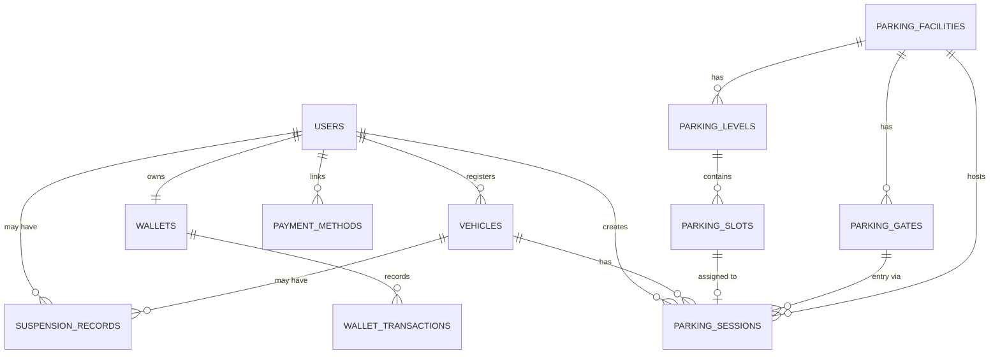
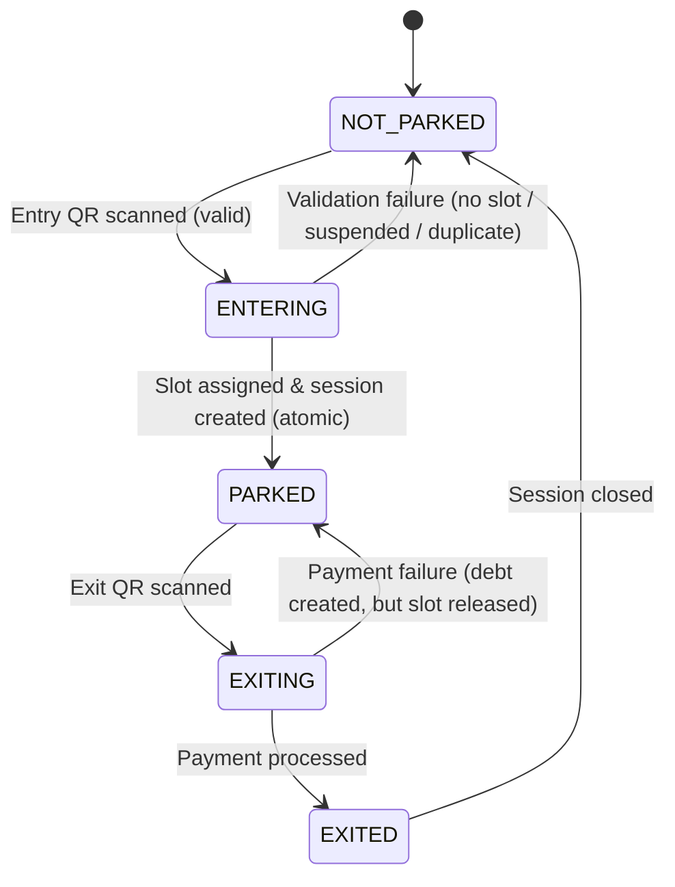
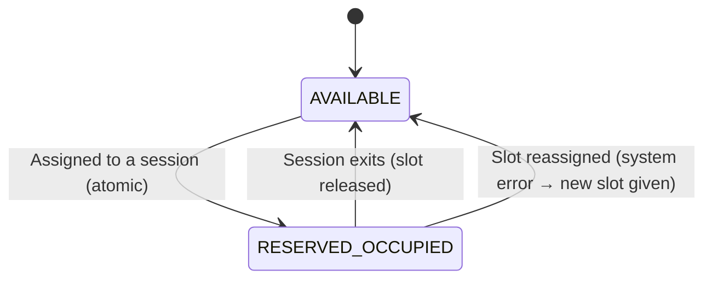
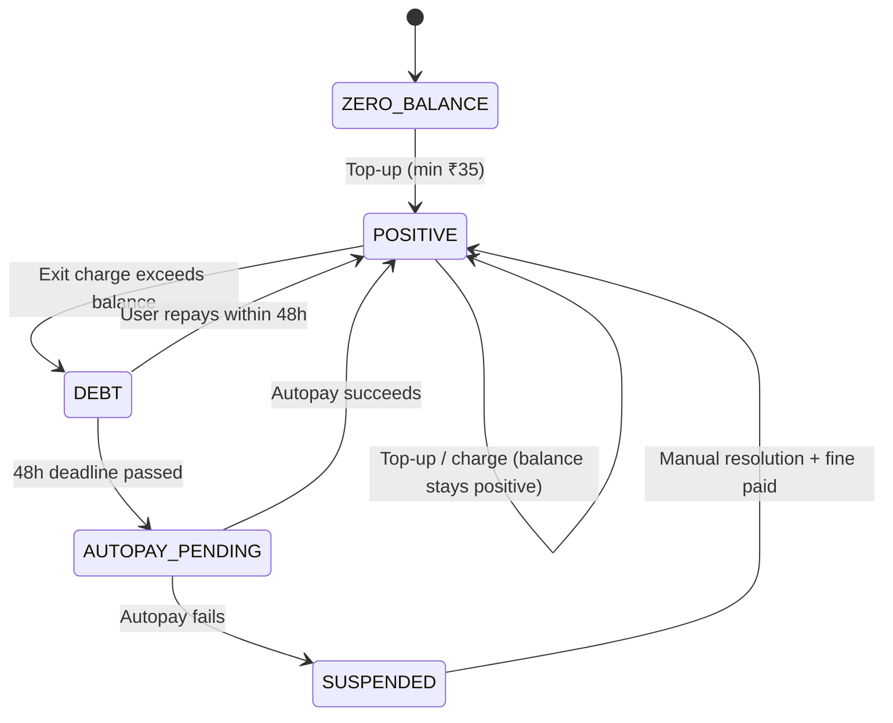

# Universal Parking System — End-to-End Build Plan

> [!IMPORTANT]
> All decisions are based on [`prerequisites.txt`](file:///d:/Codes%20&%20Projects/Parking_app/prerequisites.txt) and the locked requirements analysis. **Free tech stack only.**

---

## 1. Tech Stack Decision

### 1.1 Chosen Stack

| Layer | Technology | Why |
|---|---|---|
| **Mobile App** | Flutter (Dart) | Free, open-source, single codebase for iOS + Android, excellent QR & map plugins |
| **Backend API** | Node.js + Express.js + TypeScript | Free, massive ecosystem, ideal for real-time + REST APIs |
| **ORM** | Prisma | Free, type-safe ORM for PostgreSQL with built-in migrations |
| **Database** | PostgreSQL | Free, open-source, perfect for relational data + transactional state management |
| **Operator Dashboard** | Next.js + Tailwind CSS | Free React framework, easy deployment, SSR support |
| **Real-time** | Socket.io | Free WebSocket abstraction for live operator dashboard |
| **Auth** | JWT + bcrypt | Free, stateless authentication |
| **QR Generation** | `qrcode` npm package | Free, generates QR per gate on backend |
| **QR Scanning** | `mobile_scanner` Flutter package | Free, fast QR/barcode scanning |
| **Maps (outdoor)** | `flutter_map` + OpenStreetMap | 100% free map tiles and SDK |
| **Indoor Maps** | Custom SVG floor plans | Free; facility uploads their floor plan, app overlays slot marker |
| **Payment Gateway** | Razorpay SDK | Free to integrate (per-transaction fee is business cost, not tech cost) |
| **Push Notifications** | Firebase Cloud Messaging (FCM) | Free tier (Spark plan) |
| **File Storage** | Cloudinary | Free tier — 25 GB for floor map images |
| **Hosting — Backend** | Render.com | Free tier — 750 hrs/month |
| **Hosting — DB** | Neon.tech | Free tier — generous PostgreSQL hosting |
| **Hosting — Dashboard** | Vercel | Free tier — unlimited personal projects |
| **Dev tools** | Git + GitHub, Docker, Postman | All free |

### 1.2 Monorepo Structure

```
parking-system/
├── apps/
│   ├── mobile/          ← Flutter user app
│   ├── dashboard/       ← Next.js operator web dashboard
│   └── backend/         ← Node.js + Express API
├── packages/
│   └── shared-types/    ← Shared TypeScript types/interfaces
├── prisma/
│   ├── schema.prisma    ← Single source of truth for DB schema
│   └── migrations/
└── docs/
    └── floor-maps/      ← Sample SVG floor map assets
```

---

## 2. Data Model & Schema Design

### 2.1 Entity Relationship Diagram



### 2.2 Full Schema (Prisma)

```prisma
// ─── USERS ───────────────────────────────────────────────────────────────────
model User {
  id                  String               @id @default(uuid())
  name                String
  email               String               @unique
  phone               String               @unique
  passwordHash        String
  isSuspended         Boolean              @default(false)
  isBlacklisted       Boolean              @default(false)
  tcAcceptedAt        DateTime?            // T&C + autopay authorization timestamp
  indoorNavEnabled    Boolean              @default(false)
  createdAt           DateTime             @default(now())
  updatedAt           DateTime             @updatedAt

  vehicles            Vehicle[]
  wallet              Wallet?
  paymentMethods      PaymentMethod[]
  parkingSessions     ParkingSession[]
  suspensionRecords   SuspensionRecord[]
}

// ─── VEHICLES ─────────────────────────────────────────────────────────────────
model Vehicle {
  id            String           @id @default(uuid())
  userId        String
  licensePlate  String           @unique
  nickname      String?
  createdAt     DateTime         @default(now())

  user          User             @relation(fields: [userId], references: [id])
  parkingSessions ParkingSession[]
  suspensionRecords SuspensionRecord[]
}

// ─── WALLETS ──────────────────────────────────────────────────────────────────
model Wallet {
  id                    String               @id @default(uuid())
  userId                String               @unique
  balance               Decimal              @default(0)  // Can go negative (debt)
  debtCreatedAt         DateTime?            // When balance first went negative
  debtDeadline          DateTime?            // debtCreatedAt + 48h
  autopayAuthorized     Boolean              @default(false)
  linkedPaymentMethodId String?
  createdAt             DateTime             @default(now())
  updatedAt             DateTime             @updatedAt

  user                  User                 @relation(fields: [userId], references: [id])
  linkedPaymentMethod   PaymentMethod?       @relation(fields: [linkedPaymentMethodId], references: [id])
  transactions          WalletTransaction[]
}

// ─── WALLET TRANSACTIONS ──────────────────────────────────────────────────────
model WalletTransaction {
  id          String              @id @default(uuid())
  walletId    String
  type        TransactionType     // TOP_UP | PARKING_CHARGE | DEBT_REPAYMENT | AUTOPAY | FINE
  amount      Decimal             // Always positive; direction inferred from type
  description String
  sessionId   String?
  createdAt   DateTime            @default(now())

  wallet      Wallet              @relation(fields: [walletId], references: [id])
  session     ParkingSession?     @relation(fields: [sessionId], references: [id])
}

enum TransactionType {
  TOP_UP
  PARKING_CHARGE
  DEBT_REPAYMENT
  AUTOPAY
  FINE
}

// ─── PAYMENT METHODS ──────────────────────────────────────────────────────────
model PaymentMethod {
  id           String    @id @default(uuid())
  userId       String
  type         String    // UPI | CARD | NETBANKING
  razorpayToken String   // Razorpay saved payment token
  isPrimary    Boolean   @default(false)
  createdAt    DateTime  @default(now())

  user         User      @relation(fields: [userId], references: [id])
  wallets      Wallet[]
}

// ─── PARKING FACILITIES ───────────────────────────────────────────────────────
model ParkingFacility {
  id              String          @id @default(uuid())
  name            String
  type            FacilityType    // MALL | OFFICE | HOSPITAL | AIRPORT | etc.
  address         String
  feeRatePerHour  Decimal         @default(30.00)  // ₹30/hr default
  createdAt       DateTime        @default(now())
  updatedAt       DateTime        @updatedAt

  levels          ParkingLevel[]
  gates           ParkingGate[]
  parkingSessions ParkingSession[]
}

enum FacilityType {
  MALL
  OFFICE
  HOSPITAL
  AIRPORT
  HOTEL
  UNIVERSITY
  PUBLIC
  EVENT_VENUE
  COMMERCIAL
}

// ─── PARKING LEVELS ───────────────────────────────────────────────────────────
model ParkingLevel {
  id           String          @id @default(uuid())
  facilityId   String
  levelCode    String          // e.g. "B1", "G", "L1", "L2"
  displayName  String          // e.g. "Basement 1", "Ground Floor"
  floorMapUrl  String?         // Cloudinary URL to SVG/PNG floor plan
  totalSlots   Int
  createdAt    DateTime        @default(now())

  facility     ParkingFacility @relation(fields: [facilityId], references: [id])
  slots        ParkingSlot[]
}

// ─── PARKING SLOTS ────────────────────────────────────────────────────────────
model ParkingSlot {
  id               String          @id @default(uuid())
  levelId          String
  facilityId       String
  slotNumber       String          // e.g. "A-01", "B-14"
  status           SlotStatus      @default(AVAILABLE)
  coordinateX      Float?          // For floor map marker placement (0-100 %)
  coordinateY      Float?
  currentSessionId String?         @unique
  createdAt        DateTime        @default(now())
  updatedAt        DateTime        @updatedAt

  level            ParkingLevel    @relation(fields: [levelId], references: [id])
  currentSession   ParkingSession? @relation("SlotCurrentSession", fields: [currentSessionId], references: [id])
  sessions         ParkingSession[] @relation("SlotSessions")
}

enum SlotStatus {
  AVAILABLE
  RESERVED_OCCUPIED  // Single unified state (reserved = occupied per product decision)
  RELEASED           // Transient — immediately moves back to AVAILABLE
}

// ─── PARKING GATES ────────────────────────────────────────────────────────────
model ParkingGate {
  id           String          @id @default(uuid())
  facilityId   String
  gateType     GateType        // ENTRY | EXIT
  gateName     String          // e.g. "North Entry Gate 1"
  qrCodeData   String          @unique  // Unique string encoded in QR
  isActive     Boolean         @default(true)
  createdAt    DateTime        @default(now())

  facility     ParkingFacility @relation(fields: [facilityId], references: [id])
  entrySessions  ParkingSession[] @relation("EntryGate")
  exitSessions   ParkingSession[] @relation("ExitGate")
}

enum GateType {
  ENTRY
  EXIT
}

// ─── PARKING SESSIONS ─────────────────────────────────────────────────────────
model ParkingSession {
  id                 String          @id @default(uuid())
  vehicleId          String
  userId             String
  facilityId         String
  slotId             String
  entryGateId        String
  exitGateId         String?
  entryTime          DateTime
  exitTime           DateTime?
  durationMinutes    Int?
  feeRateSnapshot    Decimal         // Rate captured at session start (₹/hr)
  totalFee           Decimal?
  status             SessionStatus   @default(ACTIVE)
  paymentStatus      PaymentStatus   @default(PENDING)
  createdAt          DateTime        @default(now())
  updatedAt          DateTime        @updatedAt

  vehicle            Vehicle         @relation(fields: [vehicleId], references: [id])
  user               User            @relation(fields: [userId], references: [id])
  facility           ParkingFacility @relation(fields: [facilityId], references: [id])
  slot               ParkingSlot     @relation("SlotSessions", fields: [slotId], references: [id])
  currentSlot        ParkingSlot?    @relation("SlotCurrentSession")
  entryGate          ParkingGate     @relation("EntryGate", fields: [entryGateId], references: [id])
  exitGate           ParkingGate?    @relation("ExitGate", fields: [exitGateId], references: [id])
  walletTransactions WalletTransaction[]
}

enum SessionStatus {
  ACTIVE
  COMPLETED
  DISPUTED
}

enum PaymentStatus {
  PENDING       // Session active, no charge yet
  PAID          // Fee fully collected from wallet
  DEBT          // Wallet went negative; repayment window open
  AUTOPAY_PENDING // 48h passed; triggering autopay
  FINED         // Autopay failed; account suspended + fined
}

// ─── SUSPENSION RECORDS ───────────────────────────────────────────────────────
model SuspensionRecord {
  id          String    @id @default(uuid())
  userId      String
  vehicleId   String
  reason      String    // e.g. "AUTOPAY_FAILURE"
  fineAmount  Decimal   @default(0)
  isPaid      Boolean   @default(false)
  isResolved  Boolean   @default(false)
  createdAt   DateTime  @default(now())

  user        User      @relation(fields: [userId], references: [id])
  vehicle     Vehicle   @relation(fields: [vehicleId], references: [id])
}
```

### 2.3 State Machines

#### Vehicle State Machine


#### Parking Slot State Machine


#### Wallet State Machine


---

## 3. System Architecture

```mermaid
flowchart TD
    subgraph "User Mobile App (Flutter)"
        A1[Auth Screens]
        A2[Vehicle Management]
        A3[Wallet]
        A4[QR Scanner - Entry]
        A5[Slot Display + Map]
        A6[Active Session Screen]
        A7[QR Scanner - Exit]
        A8[Payment Confirmation]
    end

    subgraph "Operator Dashboard (Next.js)"
        B1[Live Session View]
        B2[Slot Occupancy Map]
        B3[Entry / Exit Log]
        B4[Session Resolution]
    end

    subgraph "Backend API (Node.js + Express + TypeScript)"
        C1[Auth API]
        C2[Vehicle API]
        C3[Wallet API]
        C4[Session API - Entry]
        C5[Session API - Exit]
        C6[Facility / Slot Admin API]
        C7[Operator API]
        C8[Debt & Autopay Worker]
        C9[Socket.io Server]
    end

    subgraph "Infrastructure (Free Tier)"
        D1["PostgreSQL (Neon.tech)"]
        D2["File Storage (Cloudinary)"]
        D3["Payment Gateway (Razorpay)"]
        D4["Push Notifications (FCM)"]
        D5["Backend Host (Render.com)"]
        D6["Dashboard Host (Vercel)"]
    end

    A4 -->|POST /sessions/entry| C4
    A7 -->|POST /sessions/exit| C5
    A3 -->|POST /wallet/topup| C3
    B1 <-->|WebSocket| C9
    C4 -->|Emit event| C9
    C5 -->|Emit event| C9
    C8 -->|Cron: check debt deadlines| D1
    C8 -->|Trigger autopay| D3
    C1 & C2 & C3 & C4 & C5 & C6 & C7 <--> D1
    D3 -->|Webhook| C3
```



### 3.1 API Surface

| Method | Endpoint | Description |
|---|---|---|
| POST | `/auth/register` | Register user account |
| POST | `/auth/login` | Login, receive JWT |
| GET | `/auth/me` | Get current user profile |
| POST | `/vehicles` | Register a vehicle (license plate) |
| GET | `/vehicles` | List user's vehicles |
| DELETE | `/vehicles/:id` | Remove a vehicle |
| GET | `/wallet` | Get wallet balance + debt status |
| POST | `/wallet/topup` | Add funds (min ₹35) via Razorpay |
| GET | `/wallet/transactions` | Transaction history |
| POST | `/sessions/entry` | Scan entry QR → create session + assign slot |
| POST | `/sessions/exit` | Scan exit QR → calculate fee + deduct + close |
| GET | `/sessions/active` | Get user's current active session |
| GET | `/sessions/history` | Past sessions list |
| GET | `/sessions/:id` | Session detail |
| GET | `/operator/sessions` | All active sessions for a facility |
| GET | `/operator/slots` | Slot occupancy by level |
| GET | `/operator/log` | Entry/exit event log |
| PATCH | `/operator/sessions/:id/resolve` | Manually resolve disputed session |
| GET | `/facilities` | List facilities |
| GET | `/facilities/:id/map` | Floor map + slot positions |
| GET | `/facilities/:id/gates/:gateId` | Gate + QR validation |
| POST | `/admin/facilities` | Create facility |
| POST | `/admin/facilities/:id/levels` | Add level |
| POST | `/admin/levels/:id/slots` | Add slots |
| POST | `/admin/facilities/:id/gates` | Add gate + generate QR |

---

## 4. Mobile App — Screen-by-Screen Flow

### 4.1 Onboarding & Auth

```
Splash Screen
    ↓
[New user] → Register Screen
    - Name, Email, Phone, Password
    - OTP verification (phone)
    - T&C acceptance screen (explicit checkbox: autopay auth, debt policy, blacklist/fine policy)
    ↓
[Existing user] → Login Screen
    - Email + Password
    - Forgot password flow
    ↓
Home Screen
```

### 4.2 Home Screen
- Active session card (if parked) — shows facility, level, slot, time elapsed, current charge
- "No active session" state with quick-scan button
- Wallet balance pill (tappable → Wallet screen)
- Bottom nav: Home | Sessions | Wallet | Profile

### 4.3 Vehicle Management
- **Vehicle List Screen:** All registered vehicles, license plates, "Add Vehicle" button
- **Add Vehicle Screen:** License plate input, optional nickname, save
- **Select Vehicle Screen:** Modal/sheet — shown before entry QR scan if multiple vehicles registered
- **Delete Vehicle:** Confirmation dialog; blocked if vehicle has active session

### 4.4 Wallet Screens
- **Wallet Home:** Balance (large, red if debt), debt repayment countdown (if applicable), "Add Money" button
- **Top-Up Screen:** Amount input (min ₹35), Razorpay payment sheet, success confirmation
- **Transaction History:** Chronological list — type icon + amount + date + description
- **Debt Warning Banner:** Persistent if wallet is in debt — shows hours remaining, repay CTA
- **Autopay Failure Screen:** Account suspended message, fine amount, resolution steps

### 4.5 Entry Flow
```
QR Scanner Screen (entry)
    ↓ (scan entry gate QR)
[If multiple vehicles] → Select Vehicle Sheet
    ↓
Processing Screen ("Verifying your vehicle...")
    ↓ [success]
Slot Assigned Screen
    - Facility name + address
    - Level (e.g., "Level 2 — L2")
    - Slot number (e.g., "B-07")
    - Floor map with slot highlighted (+ navigation toggle)
    - "Start Navigation" button (if indoor nav enabled)
    - "View Active Session" button
    ↓ [failure states]
Error Sheet — "No slots available" / "Vehicle already inside" / "Account suspended"
```

### 4.6 Active Session Screen
- Session timer (live, HH:MM:SS)
- Current estimated charge (live, updates every minute)
- Facility + Level + Slot
- Floor map with slot marker
- "I forgot where I parked" — re-shows map and directions
- Indoor navigation toggle (if user has it enabled)
- Wallet balance warning if low

### 4.7 Exit Flow
```
QR Scanner Screen (exit)
    ↓ (scan exit gate QR)
Processing Screen ("Calculating your fee...")
    ↓
Fee Confirmation Screen
    - Duration (e.g., "2 hr 15 min")
    - Fee (e.g., "₹67.50")
    - Wallet balance before → after
    - [If debt] Debt amount + 48h repayment reminder
    ↓
Exit Cleared Screen
    - "You're good to go!" 
    - Session summary card
    - "View Receipt" button
    ↓ [failure]
Error Sheet — "No active session found" / "Already exited"
```

### 4.8 Session History
- List of all past sessions — facility, date, duration, amount, status badge
- **Session Detail Screen:** Full breakdown — entry time, exit time, slot, fee, payment status, receipt

### 4.9 Profile & Settings
- Edit name / email / phone
- Linked payment methods (add/remove)
- Indoor navigation toggle (ON/OFF)
- T&C (read only)
- Change password
- Logout

---

## 5. Operator Web Dashboard — Screen Structure

### 5.1 Login Page
- Email + Password (operator account)
- Facility selector (if operator manages multiple facilities)

### 5.2 Dashboard Home
- KPI cards: Total capacity | Occupied | Available | Active sessions
- Real-time occupancy % bar per level
- Recent activity feed (entries + exits, live via WebSocket)

### 5.3 Active Sessions Table
| Column | Value |
|---|---|
| License Plate | MH12AB1234 |
| Vehicle Owner | User name |
| Level / Slot | L2 / B-07 |
| Entry Gate | North Gate 1 |
| Entry Time | 14:32 |
| Duration | 1h 23m |
| Est. Fee | ₹41.50 |
| Payment Status | Badge (ACTIVE / DEBT / FINED) |
| Action | View / Resolve |

### 5.4 Slot Occupancy Map
- Level tabs (B1, G, L1, L2…)
- Visual slot grid — green = available, red = occupied
- Click occupied slot → session detail drawer

### 5.5 Entry / Exit Log
- Chronological event log
- Filters: date range, gate, status
- Columns: Event type | Time | License plate | Slot | Gate | Payment status

### 5.6 Session Resolution Panel
- Operator can mark a session as DISPUTED
- Manually close a stuck session with a note
- Override payment status (with reason)
- Generate alternative exit QR for user without app access

---

## 6. Phased Execution Plan

### Phase 0 — Requirements & Planning ✅ DONE
- Requirements locked
- Ambiguities resolved
- Tech stack + schema + architecture decided

---

### Phase 1 — Project Foundation
**Goal:** Working monorepo with DB connection and health check

**Tasks:**
- [ ] Initialize monorepo (apps/backend, apps/mobile, apps/dashboard)
- [ ] Set up Node.js + Express + TypeScript backend
- [ ] Set up Prisma with PostgreSQL (Neon.tech local dev)
- [ ] Write full `schema.prisma` (all entities from Section 2.2)
- [ ] Run first migration
- [ ] Seed test data: 1 facility, 2 levels, 20 slots, 2 entry gates, 2 exit gates
- [ ] GET `/health` endpoint returning 200 OK
- [ ] Set up Flutter project skeleton
- [ ] Set up Next.js dashboard skeleton

**Deliverable:** Monorepo runs locally; DB is live with seed data

---

### Phase 2 — Authentication & User Management
**Goal:** Users can register, verify, log in, and view their profile

**Tasks:**
- [ ] `POST /auth/register` — create user + wallet record
- [ ] `POST /auth/login` — return JWT
- [ ] `GET /auth/me` — return user profile
- [ ] Password hashing with bcrypt
- [ ] JWT middleware (auth guard)
- [ ] T&C acceptance flag stored on registration
- [ ] Flutter: Register screen, Login screen, OTP screen (mock), T&C screen
- [ ] Flutter: JWT stored securely (flutter_secure_storage)

**Deliverable:** User can register and log in via mobile app

---

### Phase 3 — Vehicle Registration
**Goal:** User can register vehicles and select one for parking

**Tasks:**
- [ ] `POST /vehicles` — register license plate
- [ ] `GET /vehicles` — list user's vehicles
- [ ] `DELETE /vehicles/:id` — remove (if no active session)
- [ ] Unique license plate validation
- [ ] Flutter: Vehicle list screen, Add vehicle screen, Select vehicle modal

**Deliverable:** User can manage their vehicle fleet in the app

---

### Phase 4 — Wallet System
**Goal:** Prepaid wallet with top-up, balance display, and transaction history

**Tasks:**
- [ ] `GET /wallet` — balance + debt status
- [ ] `POST /wallet/topup` — Razorpay order → confirm → credit wallet (min ₹35)
- [ ] `GET /wallet/transactions` — history
- [ ] Wallet auto-created at user registration
- [ ] Flutter: Wallet home screen, top-up screen (Razorpay SDK), transaction history
- [ ] Debt warning banner component

**Deliverable:** User can top up wallet and see balance + transaction history

---

### Phase 5 — QR Code System & Facility Setup
**Goal:** Each gate has a unique, scannable QR code

**Tasks:**
- [ ] `POST /admin/facilities` — create facility
- [ ] `POST /admin/facilities/:id/levels` — add levels
- [ ] `POST /admin/levels/:id/slots` — bulk-add slots
- [ ] `POST /admin/facilities/:id/gates` — create gate + generate QR string
- [ ] `GET /admin/gates/:id/qr` — returns QR image (PNG) for printing
- [ ] Flutter: QR scanner screen using `mobile_scanner`
- [ ] QR validation logic: decode → identify gate → check gate type (ENTRY/EXIT)

**Deliverable:** Gates have printable QRs; app can scan and decode them

---

### Phase 6 — Parking Entry (Core Business Logic)
**Goal:** Scanning entry QR starts a valid, atomic parking session

**Tasks:**
- [ ] `POST /sessions/entry` with full guard logic:
  - Vehicle registered? ✅
  - Account suspended / blacklisted? ❌ reject
  - Vehicle already has active session? ❌ reject
  - Any available slot in facility? (if no → ❌ reject)
  - Atomic slot assignment (DB transaction + row lock to prevent race condition)
  - Create ParkingSession record
  - Set slot status to RESERVED_OCCUPIED
  - Emit `session.created` event via Socket.io
- [ ] `GET /sessions/active` — return active session with slot + level info
- [ ] Floor map + slot coordinate retrieval
- [ ] Flutter: Slot assigned screen, floor map with slot marker (flutter_map + SVG overlay)
- [ ] Flutter: Active session screen with live timer and estimated cost

**Deliverable:** User can scan entry QR and be assigned a slot, shown on the map

---

### Phase 7 — Parking Exit (Core Business Logic)
**Goal:** Scanning exit QR closes the session and deducts the fee

**Tasks:**
- [ ] `POST /sessions/exit` with full guard logic:
  - Valid active session for the vehicle? ✅
  - Session already closed? ❌ reject
  - Calculate duration (entry time → now)
  - Calculate fee (duration × feeRateSnapshot, rounded up to nearest minute)
  - Deduct from wallet (allow negative → debt state)
  - Set session status = COMPLETED
  - Set slot status = AVAILABLE, clear currentSessionId
  - If wallet goes negative: set debtCreatedAt, debtDeadline = +48h
  - Emit `session.closed` + `slot.released` events via Socket.io
  - Operator dashboard updates in real time
- [ ] Flutter: Exit QR scanner, fee confirmation screen, exit cleared screen
- [ ] Flutter: Debt warning shown if wallet went negative

**Deliverable:** Full end-to-end parking flow works (entry → park → exit → pay)

---

### Phase 8 — Operator Dashboard
**Goal:** Web dashboard shows real-time session and slot data

**Tasks:**
- [ ] Next.js + Tailwind setup
- [ ] Operator login + JWT auth
- [ ] Dashboard home with KPI cards
- [ ] Active sessions table (Socket.io live updates)
- [ ] Slot occupancy map (level tabs + grid)
- [ ] Entry/exit log with filters
- [ ] Session resolution panel (close disputed session)
- [ ] Alternative exit QR generation (for app-loss scenario)
- [ ] `GET /operator/sessions`, `GET /operator/slots`, `GET /operator/log`
- [ ] `PATCH /operator/sessions/:id/resolve`

**Deliverable:** Operator can monitor all sessions, slots, and events in real time

---

### Phase 9 — Debt, Autopay & Enforcement System
**Goal:** Automated debt handling, autopay, suspension, and blacklist

**Tasks:**
- [ ] Cron job (every 15 min): check all wallets where `debtDeadline < now` and `balance < 0`
- [ ] Trigger Razorpay auto-debit for linked payment method
- [ ] On autopay success: credit wallet, clear debt fields, set paymentStatus = PAID
- [ ] On autopay failure:
  - Set `user.isSuspended = true`
  - Set `user.isBlacklisted = true`
  - Create SuspensionRecord with fine amount
  - Push notification to user
- [ ] Entry guard: check isSuspended / isBlacklisted → show fine + resolution screen
- [ ] Fine payment flow (user pays fine → account reinstated)
- [ ] Flutter: Debt countdown screen, suspended account screen, fine payment flow

**Deliverable:** Automated wallet enforcement cycle fully operational

---

### Phase 10 — Edge Cases & Hardening
**Goal:** All failure scenarios from the requirements handled gracefully

**Tasks:**
- [ ] Slot reassignment if assigned slot becomes unavailable (admin marks slot inactive → system reassigns + operator alerted)
- [ ] Duplicate entry attempt: clear error response + app message
- [ ] Duplicate exit attempt: rejected, session not re-charged
- [ ] Race condition test: two users scanning entry simultaneously with 1 slot left (only one gets it)
- [ ] Indoor navigation toggle in user settings (Flutter navigation screen with turn-by-turn SVG path)
- [ ] "I forgot where I parked" button on home (re-displays floor map from active session)
- [ ] All error states have clear, non-technical user-facing messages
- [ ] All failures logged server-side with full context
- [ ] No silent failure — every error is surfaced to operator dashboard

**Deliverable:** All edge cases tested and handled per requirements spec

---

### Phase 11 — Deployment (Free Tier) ✅ COMPLETED
**Goal:** Production-ready deployment on 100% free infrastructure

**Tasks:**
- [x] Neon.tech: Production PostgreSQL database + connection pooling
- [x] Render.com: Deploy Node.js backend (`render.yaml` infrastructure-as-code for free web service)
- [x] Vercel: Deploy Next.js operator dashboard (`apps/dashboard/vercel.json` configured)
- [x] Cloudinary: Floor map asset support prepared
- [x] Firebase: Push notification architecture specified
- [x] Environment variables configured securely per platform (.env git-ignored)
- [x] GitHub Actions: CI pipeline (`.github/workflows/ci.yml` validating typechecks & builds)
- [x] Monorepo build verified & pushed to `origin main`

**Deliverable:** System live on free-tier infrastructure, accessible via public URLs

---

## 7. Build Order Summary

```mermaid
flowchart LR
    P0["Phase 0\nRequirements ✅"] --> P1["Phase 1\nFoundation"]
    P1 --> P2["Phase 2\nAuth"]
    P2 --> P3["Phase 3\nVehicles"]
    P3 --> P4["Phase 4\nWallet"]
    P4 --> P5["Phase 5\nQR System"]
    P5 --> P6["Phase 6\nEntry Logic"]
    P6 --> P7["Phase 7\nExit Logic"]
    P7 --> P8["Phase 8\nOperator Dashboard"]
    P8 --> P9["Phase 9\nDebt & Autopay"]
    P9 --> P10["Phase 10\nEdge Cases"]
    P10 --> P11["Phase 11\nDeployment"]
```



> [!TIP]
> Phases 2–5 can be partially parallelized — backend APIs and Flutter screens for each can be built simultaneously once the schema is in place.
